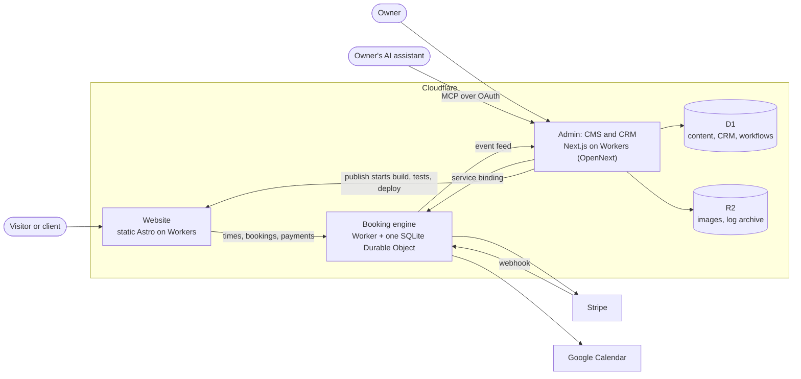

# CanArea: case study

CanArea is a small dog nutrition and dog training consultancy in Germany. I am its only developer. I built the website, the admin app, the booking and payment engine and the automation behind them. Everything runs on Cloudflare Workers.

This repository describes the system and the decisions behind it. The source code is client work and stays private, so this repository contains no code from the project and no client data.

**Role:** sole developer (freelance), 2026 to present. I worked out the requirements with the owner, then designed, built, tested and deployed the system.

**Stack:** TypeScript, Astro, Next.js 16 and React 19 (via OpenNext), Cloudflare Workers, D1, R2 and Durable Objects (SQLite), Stripe, Google Calendar API, MCP, zod, visx, Playwright, `node:test`.

## The problem

The owner runs the business alone and has about two hours a week for the website. New clients come almost only from Google search and referrals, so the website is the main sales channel. The budget for paid tools is close to zero.

She needed one system that does all of this:

- A fast public website that she can edit herself.
- Online booking with payment for consultations, and enquiries with wished times for on-site dog training.
- Invoices, refunds, five-session cards and drive-time charges, without mistakes in the money.
- A client list with pipelines, questionnaires and a history of each client.
- Automatic e-mails and status changes that she can change without a developer.
- A way for her own AI assistant to do admin work, but never to send money or messages without her approval.

## Architecture



- **Website.** A static Astro site. The owner edits content in the admin. Publishing starts a Cloudflare Workers Build: it pulls the content, builds the site, runs the unit and build tests and deploys only if they pass. The site never keeps its own names, prices or durations. It reads them from the service catalogue in the admin at build time.
- **Admin.** A Next.js app that is both the CMS and the CRM. Sign-in uses passkeys.
- **Booking engine.** A Worker with one SQLite Durable Object. It owns everything that must agree with the calendar: appointments, holds, payments, the five-session card ledger and invoices.
- **The CRM follows the engine.** The admin reads the engine's event feed and keeps clients, stages and activity in D1. It shows payments, but it never calculates them.

## Decisions I would point to

### 1. All money and calendar state in one Durable Object

A booking, a payment and an invoice must never be half-written. Two people must never get the same time.

I put the whole booking domain into one SQLite Durable Object. A Durable Object handles one request at a time, and each change runs in one SQL transaction. So the rules hold without locks:

- An online booking holds its time for 15 minutes until the client confirms the e-mail. Unpaid reservations and times the owner offers are held for 24 hours. Holds expire before every request.
- An appointment is `reserved` until it is paid, then `booked`.
- Invoice numbers have no gaps. The PDF is generated in the Worker and stored with the invoice row.
- Stripe is optional. The engine registers its own webhook when the owner enters her key. Without Stripe, she marks payments as cash or bank transfer.
- Google Calendar never stops a booking. The engine reads busy times (at most 60 seconds old while a visitor browses, 15 seconds before a booking) and writes events with a stable id after the booking is saved. If Google fails, the write waits for a retry.

### 2. Automations as data, with a dry run

The owner wanted to change e-mails and status changes herself. So I replaced hard-coded e-mails with a workflow engine and a visual builder.

- Every trigger, condition and action is described as data in one catalogue. The builder draws itself from that catalogue, so a new action is one catalogue entry and one handler.
- Workflows are versioned. A run stays on the version it started with.
- A cron tick runs every minute. A tick with no work costs three SQL statements, and a test keeps it that way.
- A tick holds a lease. Each action is marked `executing` before it runs, so a step that gets cut off fails visibly and does not send an e-mail twice. A workflow can run at most 10 times per client and hour, and cycles are refused, which stops loops.
- **Dry run.** The owner can test a workflow on copies of the data, with its own clock that jumps to the next due step. During a dry run, every function that can reach live data, send mail or start a deploy throws. Tests check that each table is classified as "copy", "copy on request" or "empty", so a new table cannot leak into a dry run by accident.
- 15 standard workflows (booking confirmed, payment request, cancellation and others) ship as defaults. The owner can change, pause or reset each one.

### 3. One typed operation layer for the UI and for AI agents

The owner wants to use her own AI assistant for admin work. An agent must be able to do what she can do, but it must not move money or contact a client without her approval.

Every change in the admin is one typed operation with a zod schema. There are about 160 of them, in three kinds: `read`, `write` and `confirm`. The admin's server actions and an MCP server both call the same operations:

```ts
// Simplified shape of an operation
defineOp({
  name: 'clients.set_stage',  // the MCP tool is clients_set_stage
  kind: 'write',              // read | write | confirm
  input: z.object({ clientId: id, stage: id }),
  run: async (ctx, input) => { /* ... */ },
});
```

- A `confirm` operation (refund, cancel, publish, delete and similar) from an agent does not run. It becomes an approval request in the owner's inbox, and the tool answers `pending`.
- Every operation is audited as the owner, as the agent, or as "the owner, confirmed for the agent".
- Agents connect with OAuth or an API key. Sign-in, user management and payment keys are never exposed to an agent.
- A test reads every server action in the admin and fails if it does not go through an operation. A new admin feature therefore reaches the agent by design, or it must be on a list of UI-only actions with a reason.

### 4. Tests as the only gate

No external CI service runs for this repository, so the local `pnpm verify` is the gate before every push, and the Cloudflare build runs the website tests again before each deploy.

- About 190 test files with about 1,500 test cases: `node:test` unit tests, build tests that read the built HTML with JSDOM, and Playwright browser tests.
- Each check runs at the lowest level that can see it. Logic is unit-tested. Page content is checked in the build. The browser runs only what needs a browser.
- The browser tests run in up to eight projects: Chromium and WebKit, desktop and phone, dark and light theme. Each test has a tier. Behaviour tests run in two projects, layout tests in four and theme tests in all eight. This keeps the gate fast without losing coverage.
- The e-mail tests drive the real booking engine, sync and workflow runner, not mocks. They walk every booking path and fail if a new engine event has no e-mail path yet.
- `verify` skips an area (website, booking, admin) that has not changed since it last passed, and retries a failed browser test once. A test that passes only on retry is reported as flaky and investigated.

### 5. Logs that can follow one click

- Both Workers write one JSON line per request, operation, outside call, cron minute and alarm.
- The admin passes a trace id to the engine in a header, so one click is visible across both Workers.
- Log lines contain ids, never personal data.
- Errors are counted in D1 and e-mailed. On a paid Cloudflare plan, Logpush archives the logs in R2 for 30 days. The admin and its MCP tools can search errors and logs.

## How I work

I build with coding agents. I write the requirements, the rules in `AGENTS.md` and the tests. Agents write much of the code, and most commits are co-authored with Claude. Every change must pass the full test gate. Before a merge, a model from a second vendor reviews the change, and I check each finding against the code before I act on it.

## Numbers (November 2026)

| | |
| --- | --- |
| Commits | about 340, since October 2026 |
| Source code | about 140,000 lines of TypeScript, TSX and Astro (without tests) |
| Tests | about 190 files, about 1,500 test cases, about 48,000 lines |
| Admin operations | about 160 (read, write, confirm) |
| Browser projects | 8 (Chromium, WebKit × desktop, phone × dark, light) |

## Contact

Anton Metzner Rodriguez. Open to early-career software engineering roles. Reach me through my [GitHub profile](https://github.com/Anton-M-R).
